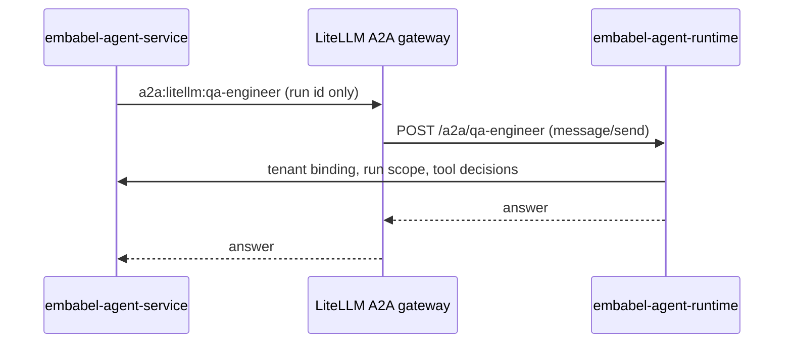

# A2A agents

A workflow is a chain of agents. Those agents can come from two places: Markdown files in your
repository, or any provider that speaks the [Agent2Agent (A2A)](https://a2a-protocol.org/) protocol.

<VersionBanner version="v0.1.5 (draft)" />

## Two kinds of agent reference

| Reference                | Source                                        | Example                  |
| ------------------------ | --------------------------------------------- | ------------------------ |
| `local:<agent-id>`       | A Markdown definition in the `agents/` folder | `local:security-reviewer` |
| `a2a:<provider>:<agent>` | An agent served by an A2A provider gateway    | `a2a:litellm:qa-engineer` |

Both appear in the agent catalogue in the dashboard, one section per source. Locally the A2A provider is
the LiteLLM gateway, which serves the four seeded agents: `business-analyst`, `solution-architect`,
`software-developer` and `qa-engineer`.

## How a call travels

The caller names only a run id. The runtime asks the workflow engine for that run's repository and
workspace, so an A2A caller cannot pick its own scope. Tool access still needs both the agent definition
and the tenant binding, and every call is policy-checked.

## Adding another provider

You can register further LiteLLM-compatible A2A gateways in the dashboard under
**Workflow designer, Configuration, A2A services**. Their secrets are stored encrypted, and nothing can be
stored without the encryption key.

## Limits

- Only A2A version 0.3 and `message/send` are supported. No streaming, tasks or push notifications.
- The tenant claim exists only for the local service client, which is fixed to `tenant_id=local`.
- Remote A2A agents provide no definition content, so skills and instructions come from the local source.

## Go deeper

- [A2A agents reference](/reference/integrations/a2a-agents), including how to run the round-trip script.
- [Build your own agent](../tutorials/custom-agent.mdx), for the `local:` route.
- [Agent runtime reference](/reference/concepts/agent-runtime).
