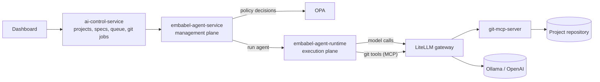

# Architecture deep dive

OpenJCockpit is a set of Java services and a React dashboard. The design keeps **deciding what runs**
apart from **running it**, so that policy, approval and audit sit in one place and the code that calls
LLMs sits in another.

<VersionBanner version="v0.1.5 (draft)" />

## The services in one picture

| Service                   | Think of it as                                                                                    |
| ------------------------- | ------------------------------------------------------------------------------------------------- |
| `ai-control-service`      | The front door: projects, encrypted Git credentials, spec files, the spec queue and Git jobs.     |
| `embabel-agent-service`   | The management plane: workflows, approval gates, policy decisions, run history and audit. No LLM. |
| `embabel-agent-runtime`   | The execution plane: the only process that runs agents and calls models.                          |
| `git-mcp-server`          | Git and GitHub tools over MCP, with credentials resolved server-side.                             |
| LiteLLM, OPA and Keycloak | Model, agent and tool gateway; policy engine; identity.                                           |

## Why two planes

The workflow engine decides *which* agent runs, in what order, under which gates. The runtime runs it.
They are separate processes that share no database, volume or in-memory object. Everything crosses an
authenticated HTTP contract, and each side only accepts calls from the right Keycloak client.

What that buys you:

- **Small blast radius.** LLM keys live only in the runtime. The management plane has no LLM credentials.
- **One policy decision point.** The runtime asks the agent service about every tool call and denies the
  call when it gets no answer.
- **Movable runtime.** The runtime can move to another host by configuration alone.

## One run, step by step

1. You start a workflow on a spec. `ai-control-service` clones the repository and creates the run branch.
2. `embabel-agent-service` asks OPA whether the workflow may start.
3. For each agent in order, the runtime resolves the agent against the tenant binding, calls the model
   through LiteLLM, and asks for a policy decision before every tool call.
4. After each agent, the engine makes a checkpoint commit on the run branch.
5. If a gate is set on that agent, the run pauses until you accept, deny or accept with comments.
6. When the run completes, the final commit is pushed and you review the branch.

## Design ideas worth remembering

- The workflow is the only way to run an agent, so every run gets the same policy, gates, audit and Git handling.
- Agents are configuration (Markdown files or A2A agents), not code.
- Tools are granted server-side and checked at call time. Prompts cannot grant a tool.
- Git is the delivery and audit medium: one branch per run, one checkpoint per agent.

## Limits

- `embabel-agent-service` and `ai-control-service` run as single replicas.
- An agent execution is one synchronous request. There is no streaming, and a running agent cannot be
  cancelled mid-way; stopping a run takes effect between agents.

## Go deeper

- [Architecture reference](/reference/concepts/architecture), with the full component table and sequence diagram.
- [Agent runtime reference](/reference/concepts/agent-runtime), with the internal contract and failure codes.
- [Why agents never see your Git credentials](credential-isolation.mdx).
- [Known limitations](/reference/operations/known-limitations).
