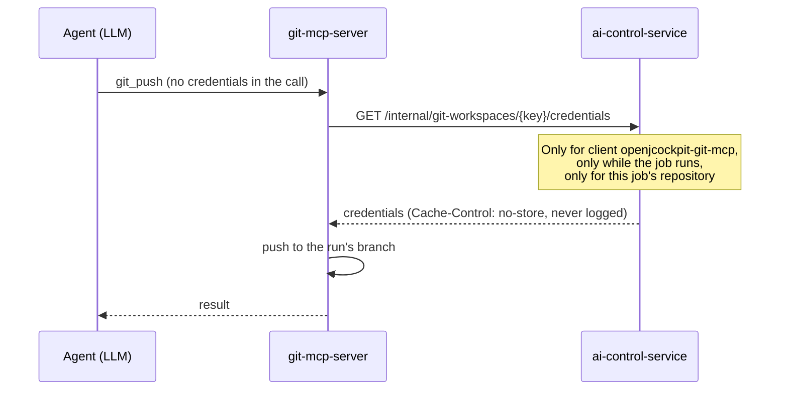

# Why agents never see your Git credentials

An agent that can push code must not be able to leak the token it pushes with. OpenJCockpit solves
this by making sure the token is never part of anything the model sees.

<VersionBanner version="develop (draft)" />

<WrittenAndVideo videoTitle="Credential isolation in five minutes">

## The idea

No Git tool has a `username` or `token` argument. The model can ask to "push", but it cannot supply,
read or repeat a credential, because none is in its prompts, tools or outputs.

## Four guarantees

| Guarantee             | How                                                                                               |
| --------------------- | ------------------------------------------------------------------------------------------------- |
| Right caller only     | The credentials endpoint accepts only the Keycloak client `openjcockpit-git-mcp`, otherwise `403` |
| Right time only       | Credentials are served only while the job runs                                                    |
| Right repository only | Only for the job's project repository, otherwise `404`                                            |
| No trace              | `Cache-Control: no-store`, and the values are never logged                                        |

The endpoint is not part of the public API contract and is not reachable through the dashboard proxy,
which forwards `/api/` only. A workspace without a key is anonymous, and a key without credentials
fails closed.

</WrittenAndVideo>

## Related controls

- **Scope is not chosen by the model.** Git tools use the run's repository and workspace, never values
  the LLM picks.
- **Policy checks every tool call** before it runs. See [policy as code](../tutorials/policy-as-code.mdx).
- **One branch per run.** Even a misbehaving agent only touches its own branch, which you review.

## Limits

- Credentials in `WorkflowStartInput` still exist for dashboard starts, but jobs do not use them.
- A third party with the `openjcockpit-git-mcp` client secret could request credentials. Treat service
  client secrets like any other secret. The local ones are public examples.

<LocalOnlyWarning />

Read more in the product
[Git integration](/reference/workflows/git-integration#git-credentials-never-reach-litellm-or-an-llm)
and [security considerations](/reference/governance/security-considerations).
