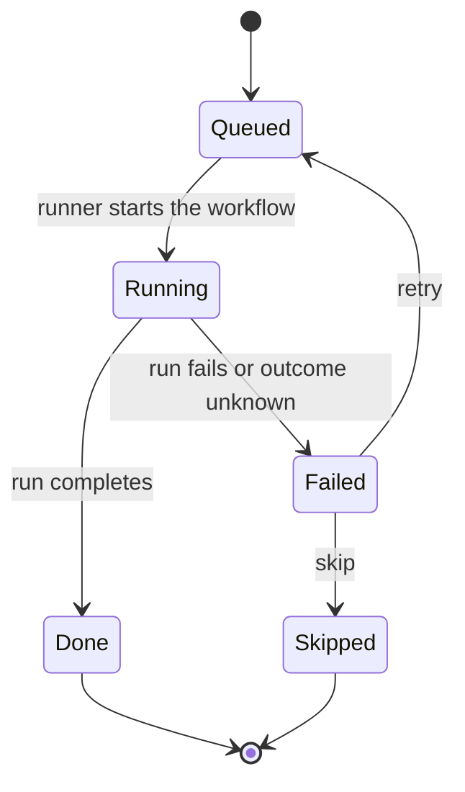

# Spec queue and workflow chaining

One spec, one run is a good way to learn. A real project has many specs. The **spec queue** runs them
one after another and starts the next run when the previous item is done.

<VersionBanner version="v0.1.5 (draft)" />

## How it works

- There is **one queue per project**, and items run one at a time.
- A background runner in `ai-control-service` starts the next workflow run.
- A manual workflow start on the project is rejected with `409 SPEC_QUEUE_ITEM_ACTIVE` while an item is active.
- You can enqueue, edit, reorder, cancel or remove items, and pause or resume the queue.

## A failed item halts the queue

This is deliberate. When an item fails, the queue stops until a human retries, skips or removes it and
resumes the queue. One bad run cannot silently cascade into the next spec.

## Auto-merge is opt-in and admin-only

Auto-merge is off by default. The project setting `autoMergeAllowed` defaults to `false`, and only users
with the `openjcockpit-admin` realm role can change it. Even then:

- Only items with exactly one pull request can be auto-merged.
- The runner finds the pull request from a `pull-request:` artifact in the run. The default workflows push a
  branch without one, so auto-merge does not apply to them yet.
- Merging is GitHub-only.

## Residual risks to know about

- A long run or an unmerged pull request holds the project's slot.
- A workflow start with an unclear outcome fails the item as `START_OUTCOME_UNKNOWN`. The run may still
  exist, and a human has to check the workflow executions.
- The runner never retries a call that may have had an effect, such as a merge request.

## Go deeper

- [Spec queue reference](/reference/workflows/spec-queue), with environment variables, token scopes and rollback.
- [Your first spec-driven change](../tutorials/first-spec-driven-change.mdx).
- [Approval gates](../tutorials/approval-gates.mdx), the human checkpoint inside each run.
