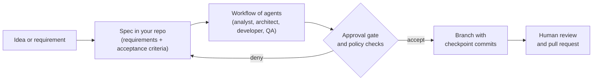

# What is OpenJCockpit?

OpenJCockpit is an open-source **AI Software Factory**. Instead of one AI assistant writing code in
isolation, it runs **teams of specialised AI agents** through **specification-driven workflows**, with
policy checks, human approval gates and reviewable Git delivery built in.

You decide what gets built, which agents may do what, and where a human must approve. The agents do
the work in a branch you review.

<VersionBanner version="develop" />

<WrittenAndVideo videoTitle="What is OpenJCockpit? (3 minutes)">

## The problem

Coding agents are good at producing code. Shipping software that a team can stand behind takes more:
clear requirements, a sound design, tests, review, policy and controlled delivery. Without structure,
AI-generated changes are hard to trust, hard to trace and hard to govern.

## The idea in one picture

## Four ideas to remember

| Idea                  | What it means                                                                                               |
| --------------------- | ----------------------------------------------------------------------------------------------------------- |
| **Spec-driven**       | A specification in your repository is the contract. Agents implement it, and you review against it.         |
| **Role-based agents** | Business analyst, solution architect, software developer and QA engineer each build on the previous output. |
| **Governed**          | OPA policies decide what agents may do. Approval gates stop a run until a person decides.                   |
| **Reviewable**        | Every run works on its own Git branch with checkpoint commits. Nothing lands without your review.           |

</WrittenAndVideo>

## Who this site is for

- **Java developers** who want to try spec-driven agentic development on a real project. Start with
  the quickstart.
- **Tech leads and architects** who care about governance and where humans stay in the loop. Start
  with the tutorials on approval gates and policy as code (coming in a later phase).

## Where to go next

1. [Quickstart](getting-started/quickstart.mdx): get the stack running locally.
2. [Tutorials](tutorials/index.mdx): hands-on walkthroughs, from first change to custom agents.
3. [Reference](/reference): the product documentation, kept in the OpenJCockpit repository and
   published here. Tutorials link to it instead of repeating it.
