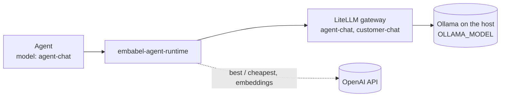

# Bring your own model

## What you will build

You will point all agents at a different local Ollama model by changing one variable, and check that the
change reached the gateway. You also learn why a hosted model is not a one-line change.

<Prerequisites
  items={[
    <>
      The running stack from the{" "}
      <a href="../getting-started/quickstart">Quickstart</a>
    </>,
    <>
      A second model that fits your hardware, for example one you already have
      in <code>ollama list</code>
    </>,
  ]}
/>

<VersionBanner version="v0.1.5 (draft, not yet verified on a clean machine)" />
<ModelNote />

<WrittenAndVideo videoTitle="Bring your own model">

## How models are wired

Agents never name a model directly. They name an **[alias](/learn/concepts/glossary#alias-model)** such as `agent-chat`, and the [LiteLLM](/learn/concepts/glossary#litellm)
gateway maps each alias to an upstream model.



In `infrastructure/litellm/config.yaml` every alias reads the same variable, `OLLAMA_MODEL`. One
change moves all of them.

## Steps

### 1. Pull the new model

```bash
ollama pull <model-tag>
ollama list
```

### 2. Set the variable

In `OpenJCockpit/.env`:

```bash
OLLAMA_MODEL=<model-tag>
```

The value must exist in `ollama list`.

### 3. Recreate the services that use it

```bash
docker compose up -d litellm embabel-agent-runtime
```

### 4. Prove it reached the container

Do not trust that `.env` did what you meant. Ask the container:

```bash
docker compose exec litellm env | grep OLLAMA_MODEL
```

<Checkpoint>
  The output shows your new tag. Run a small workflow and confirm the agents
  answer. Expect different speed and quality from the previous model.
</Checkpoint>

</WrittenAndVideo>

## What about a hosted model?

It is not a one-line change in the current stack, for two reasons from the product docs:

- The LiteLLM container deliberately has **no** `OPENAI_API_KEY`. Routing an alias to a hosted model
  through the gateway means changing `docker-compose.yml` and `config.yaml`, and deciding where that
  key may live.
- The documented fallback to OpenAI (`EMBABEL_MODELS_DEFAULT_LLM=gpt-4.1-mini`) bypasses the gateway
  and its PII filter. In the current compose file, `.env` alone does not appear to reach the
  `embabel-agent-runtime` container, so verify with
  `docker compose exec embabel-agent-runtime env | grep -E "LLM_CODING_ROUTE|EMBABEL_MODELS"` first.

Treat a hosted variant as a separate tutorial, once it has been tried and verified.

## What just happened

You changed which model answers without touching any agent. That is the point of aliases. It also means
a weaker model changes every agent at once, so re-run your specs and review the branches the same way.

Read more in the product
[LLM providers](/reference/integrations/llm-providers).

## Troubleshooting

- Every agent run fails after the change: the tag is not in `ollama list`, or the daemon stopped.
  Health stays `UP` either way.
- Runs fail after setting `OLLAMA_BASE_URL=http://localhost:11434`: that value applies inside the
  container, where nothing listens. Remove the override.
- On Linux, Ollama must listen on an address the container can reach. Binding to all interfaces exposes
  an unauthenticated endpoint to your network, so prefer a narrower bind or a firewall rule.

## Next steps

You have now seen all eight pieces. Read the [glossary](../concepts/glossary.md), and revisit the
[policy tutorial](policy-as-code.mdx) to govern your new agent.
