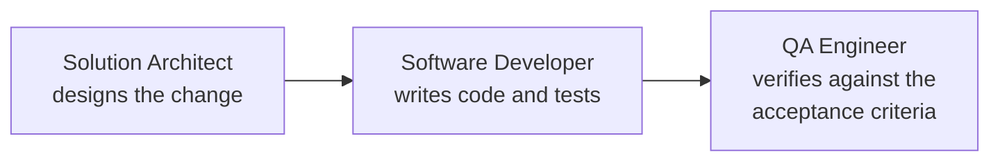

# Your first spec-driven change

## What you will build

You will add an ISBN field to a small Spring Boot API by writing no code yourself. A spec describes the
change, a workflow of agents implements it on its own Git branch, and you review the result.

<Prerequisites
  items={[
    <>
      The running stack from the{" "}
      <a href="../getting-started/quickstart">Quickstart</a>
    </>,
    <>
      A GitHub account and a fork of{" "}
      <a href="https://github.com/OpenJCockpit/openjcockpit-demo-shop">
        openjcockpit-demo-shop
      </a>
    </>,
    "A GitHub token that can push branches to your fork",
    "JDK 25 and Maven 3.9 or newer, to verify the result locally",
  ]}
/>

<VersionBanner version="develop (draft, not yet verified on a clean machine)" />
<ModelNote />

<WrittenAndVideo videoTitle="Your first spec-driven change (end to end)">

## Steps

### 1. Add the project

In the dashboard, add a project with the URL of your fork. Then add a Git credential under
**Settings → Git credentials**. Use a throwaway token and keep it off screen when recording.

<Checkpoint>The project appears in the project selector.</Checkpoint>

### 2. Initialize the spec structure

Select the project and open the spec files area. The repository has no `.specify` folder on its base
branch, so the dashboard offers the **spec-init flow**. It pushes a starter template branch.
Review that branch and merge it on GitHub.

<Checkpoint>
  The dashboard no longer offers spec-init, and shows the **Create spec with
  prompt** button or your existing specs.
</Checkpoint>

### 3. Bring in the first spec

The demo repository already contains
[`specs/001-add-isbn-field/spec.md`](https://github.com/OpenJCockpit/openjcockpit-demo-shop/blob/main/specs/001-add-isbn-field/spec.md).
You can also [download it](pathname:///openJCockpit-education/downloads/specs/001-add-isbn-field.md).
Read it first. It has three requirements and four acceptance criteria, each of them testable.

Prefer to write your own? Use **Create spec with prompt**. It starts the _Create spec from prompt (RAG)_
workflow with the Business Analyst agent.

<Checkpoint>
  The spec `001-add-isbn-field` is listed for the project.
</Checkpoint>

### 4. Run the implementation workflow

Select the spec and start the **Implement spec** workflow. Its agents run in order:



Follow the run live in the workflow execution view: agent sequence, logs, outputs, policy decisions
and the Git branch.

:::note
Expect this to be slow on a local model. Each agent call can take minutes.
:::

<Checkpoint>
  All three agents finish and the run shows a Git branch with one checkpoint
  commit per agent.
</Checkpoint>

### 5. Review the branch

The default workflows do not open a pull request or merge anything. Open the branch on GitHub and read
the diff against your spec.

```bash
git fetch origin
git switch <run-branch>
mvn verify
```

Compare each acceptance criterion with a test. If a criterion has no test, that is a review finding.

<Checkpoint>
  <code>mvn verify</code> passes, and{" "}
  <code>GET /api/books/isbn/{"{isbn}"}</code> returns a created book.
</Checkpoint>

### 6. Open a pull request

Open a pull request from the run branch the way you would for a colleague's change. Merging is your
decision.

</WrittenAndVideo>

## What just happened

The spec was the input contract. The workflow chained role-based agents, each building on the previous
output, and every output was committed as a checkpoint on a separate branch. Nothing reached your base
branch without your review. Read more in the product docs on
[spec-driven development](https://github.com/OpenJCockpit/OpenJCockpit/blob/main/docs/readme/workflows/spec-driven-development.md)
and [agents and workflows](https://github.com/OpenJCockpit/OpenJCockpit/blob/main/docs/readme/workflows/agents-and-workflows.md).

Relevant limitations: output varies from run to run on a local model, and the default workflows have no
approval gate. See [known limitations](https://github.com/OpenJCockpit/OpenJCockpit/blob/main/docs/readme/operations/known-limitations.md).

## Troubleshooting

- A job fails to start its container: run `docker pull eclipse-temurin:25-jre`.
- A start on the project returns `502`: the clone failed. Check the project URL and the Git credential.
- The dashboard shows "run state lost": the run id expired or the service restarted mid-agent. Start
  the workflow again.

## Next steps

Spec 002 adds input validation, and spec 003 changes two classes. Try them for more practice. The
[approval gates](approval-gates.mdx) tutorial builds on it.
