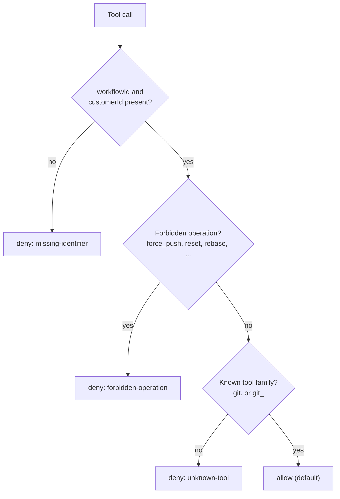

# Policy as code

## What you will build

You will extend OpenJCockpit's default OPA policy with one rule: the QA Engineer agent may read the
repository but never change it. You test the rule, then see it block a tool call.

<Prerequisites
  items={[
    "Docker",
    <>
      A checkout of <code>OpenJCockpit</code>, and the running stack for the
      last step
    </>,
    <>
      The files in{" "}
      <a href="pathname:///OpenJCockpit-docs/downloads/policy/BLOCKED_RUN_WALKTHROUGH.md">
        downloads/policy
      </a>
    </>,
  ]}
/>

<VersionBanner version="v0.1.5 (draft). The rule and tests were verified with OPA 0.70.0; the live-stack step is not yet verified." />

<WrittenAndVideo videoTitle="Policy as code: a rule that blocks an agent">

## Background: what is evaluated

OPA is asked for a decision on workflow starts, agents, skills and **every tool call**. Each decision
returns `allowed`, `reason`, `requiredApproval`, `riskLevel` and `auditTags`.

The default policy, `infrastructure/opa/policies/workflow_decision.rego`, evaluates rules top to
bottom and the first match wins:



It is a starting point, not final governance logic.

## Steps

### 1. Read the example rule

The downloadable `workflow_decision.rego` is the default policy plus one branch, before the
restricted-project rule:

```rego
} else = result {
	qa_write_attempt
	result := {
		"allowed": false,
		"reason": sprintf("Agent '%v' is read-only; tool '%v' changes the repository.", [input.agentId, tool_label]),
		"requiredApproval": false,
		"riskLevel": "high",
		"auditTags": ["guardrail", "qa-read-only"],
	}
}
```

and its helper:

```rego
write_operations := {"write_file", "commit", "push", "create_branch"}

qa_write_attempt {
	tool_call
	is_string(input.agentId)
	endswith(lower(input.agentId), "qa-engineer")
	write_operations[tool_operation]
}
```

### 2. Run the tests

```bash
cd downloads/policy
docker run --rm -v "$PWD:/p:ro" openpolicyagent/opa:0.70.0 test /p -v
```

<Checkpoint>
  OPA reports <code>PASS: 15/15</code>: the 12 default tests and 3 for the new
  rule.
</Checkpoint>

### 3. Ask for a decision

```bash
docker run --rm -v "$PWD:/p:ro" openpolicyagent/opa:0.70.0 \
  eval -d /p/workflow_decision.rego -i /p/blocked-input.json \
  'data.openjcockpit.workflow.decision' --format pretty
```

<Checkpoint>
  The result has <code>"allowed": false</code> and the audit tags{" "}
  <code>guardrail</code> and <code>qa-read-only</code>.
</Checkpoint>

### 4. Try it in the stack

Copy the file over `infrastructure/opa/policies/workflow_decision.rego`, restart OPA with
`docker compose restart opa`, run a workflow and read `docker compose logs opa`. Check the real
`agentId` in the decision log first, because the rule matches ids that end in `qa-engineer`.

</WrittenAndVideo>

## What just happened

You changed behaviour by editing a file, not Java code. Policies are mounted as plain files, so a
restart is enough. Every tool call goes through a policy-guarded path, and with OPA enabled a denial
blocks the call. Decisions are written to the decision log for audit.

Limits to know:

- With `OPA_ENABLED=false` every decision is allowed. Production runs with fail-closed enforcement and
  a locked config.
- The default policy is permissive. Replace it with your organization's rules.
- A tool call's decision input has `agentId`, `projectName`, the tool name and operation. It does
  **not** carry a project classification, so rules on `projectClassification` do not fire for tool
  calls.
- Audit records are files in a Docker volume, not a tamper-evident store.

See [policy enforcement](/reference/governance/policy-enforcement).

## Troubleshooting

- Agent tool calls are denied for every agent: the policy input lacks `workflowId` or `customerId`,
  for example an agent run outside a workflow. Start agents through a workflow.
- Your rule never fires: compare your `agentId` pattern with the real value in `docker compose logs opa`.

## Next steps

[Credential isolation](../concepts/credential-isolation.mdx) explains why agents never see your Git
credentials.
